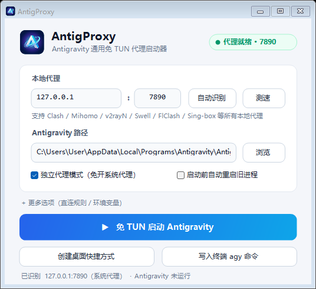

# AntigProxy

[](https://github.com/wanghaihua/Antigproxy/actions/workflows/release.yml)
[](https://github.com/wanghaihua/Antigproxy/releases/latest)
[](LICENSE)

**Antigravity 通用免 TUN 代理启动器（Windows）** —— 无需开启代理软件的虚拟网卡 TUN 模式，也不必常开全局系统代理，适用于 **Clash / Mihomo / v2rayN / Swell / FlClash / NekoRay / Sing-box** 等所有常见本地代理客户端。

> 原理参考社区分享：[linux.do/t/topic/3246449](https://linux.do/t/topic/3246449)《Windows 免tun/全局代理 启动 Antigravity 反重力》

<p align="center">
  
</p>

## 核心特性

- **通用自动探测**：优先读取 Windows 系统代理，若未开启则自动扫描常见本地代理端口（`7890 / 7897 / 10809 / 10808 / 2080 / 20171 / 1080 / 1087 / 8080 / 8888`），也支持任意自定义地址和端口。
- **免 TUN 全进程注入**：启动 `Antigravity.exe` 时向进程树自动注入 `HTTP_PROXY` / `HTTPS_PROXY` / `NO_PROXY` / `ELECTRON_NO_ATTACH_CONSOLE=1`，并默认附加 `--proxy-server` 参数，关闭系统代理也能让主界面与 `language_server` 子进程稳定走代理。
- **单实例防失效保护**：自动检测是否已有未带代理的旧 Antigravity 进程，支持启动前一键重启旧进程，确保代理环境变量完整生效。
- **开箱即用**：绿色单文件 EXE（无需安装额外运行库），支持就地一键测速、一键创建桌面快捷方式与一键写入终端 `agy` 命令。

## 下载与使用

1. 前往 [**Releases**](https://github.com/wanghaihua/Antigproxy/releases/latest) 页面下载最新的 `AntigProxy.exe`。
2. 确保本地代理客户端已启动（无需开 TUN），双击运行 `AntigProxy.exe`。
3. 确认代理端口并可点击 **「测速」** 验证连通性，点击 **「免 TUN 启动 Antigravity」**。
4. 推荐点击 **「创建桌面快捷方式」** 或 **「写入终端 agy 命令」**，之后即可直接双击快捷方式或终端输入 `agy` 静默免 TUN 启动。

## 命令行参数

- `AntigProxy.exe`：打开图形界面
- `AntigProxy.exe --launch`（或 `-l`）：静默注入代理并直接启动 Antigravity
- `AntigProxy.exe --launch --restart`：先结束已有旧进程，再静默重新启动

## 本地自行编译

无需安装 Visual Studio 或 .NET SDK，直接使用 Windows 自带 .NET Framework 编译器即可构建：

```powershell
powershell -ExecutionPolicy Bypass -File .\build.ps1
```

## 自动发布（GitHub Actions）

本仓库已配置 [.github/workflows/release.yml](.github/workflows/release.yml)：
- 推送代码到 `main` 分支：自动在 `windows-latest` 上编译验证并上传构建产物。
- 推送 `v*` 标签（如 `v1.0.0`）或在 GitHub **Actions → Build & Release AntigProxy → Run workflow** 中填写版本号：自动编译 `AntigProxy.exe`、生成 `SHA256SUMS.txt` 并发布到 GitHub Releases。
